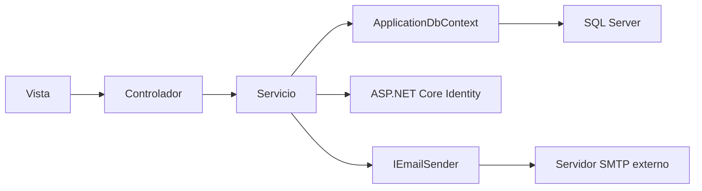

# Diagrama de arquitectura

## Responsabilidad de los controladores

Los controladores no contienen lógica de negocio. Su única tarea es recibir el pedido que llega desde la vista, revisar que los datos del formulario estén completos y bien escritos, llamar al servicio que corresponde y elegir qué pantalla mostrar como respuesta. Todas las reglas del sistema, por ejemplo que un equipo esté disponible antes de asignarlo, que no se repita una solicitud o que un cambio de estado sea válido, se comprueban en los servicios. Así cada regla está escrita en un solo lugar y no depende de la pantalla desde la que se use.
