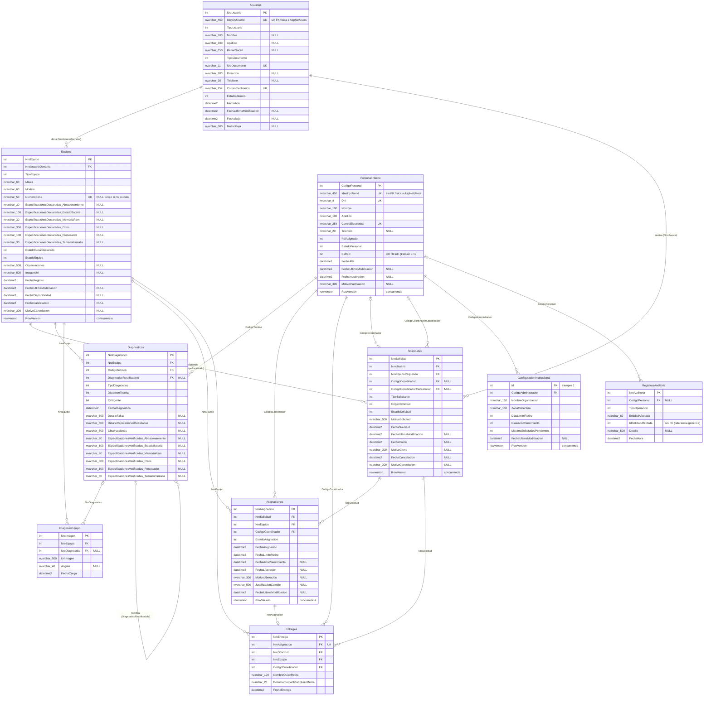

# Modelo de base de datos

Modelo relacional resultante en SQL Server (Entity Framework Core). Los tipos, longitudes, claves, índices y restricciones se tomaron de `src/TPF.RecuperacionTecnologica.Web/Data/Configurations` y de las migraciones (`Migrations/ApplicationDbContextModelSnapshot.cs`).

## Convenciones

- `PK` clave primaria, `FK` clave foránea, `UK` columna con índice único.
- Las claves primarias son `int` con `IDENTITY`, salvo `ConfiguracionInstitucional.Id`, que se asigna manualmente y vale siempre 1.
- Todas las claves foráneas usan `ON DELETE NO ACTION` (`DeleteBehavior.Restrict`): no hay borrado en cascada entre tablas de negocio.
- Las enumeraciones del dominio se guardan como `int`.
- Las columnas `RowVersion` son de tipo `rowversion` y se usan como token de concurrencia optimista (ver [Control de concurrencia](#control-de-concurrencia)).
- `EspecificacionesTecnicas` es un objeto de valor: no tiene tabla propia. Sus seis campos se guardan como columnas con prefijo en `Equipos` (`EspecificacionesDeclaradas_*`) y en `Diagnosticos` (`EspecificacionesVerificadas_*`).
- Las notaciones `o|` y `o{` del diagrama indican relación opcional (la clave foránea admite `NULL`).

## Diagrama entidad-relación

> En el diagrama, Mermaid no admite paréntesis en los tipos, por lo que `nvarchar_100` equivale a `nvarchar(100)`.

## Relación con ASP.NET Core Identity

Las tablas de ASP.NET Core Identity (`AspNetUsers`, `AspNetRoles`, `AspNetUserRoles`, `AspNetUserClaims`, `AspNetRoleClaims`, `AspNetUserLogins`, `AspNetUserTokens`) **no se incluyen** en el diagrama.

`Usuarios` y `PersonalInterno` se relacionan con `AspNetUsers` de forma **indirecta**: ambas tablas guardan en `IdentityUserId` (`nvarchar(450)`, único) el `Id` de la cuenta de Identity. **No existe clave foránea física** entre ellas; la integridad de esa referencia la garantiza la aplicación.

## Claves foráneas

| Tabla origen | Columna | Tabla destino | Obligatoria |
|---|---|---|---|
| Equipos | NroUsuarioDonante | Usuarios | Sí |
| Solicitudes | NroUsuario | Usuarios | Sí |
| Solicitudes | NroEquipoRequerido | Equipos | Sí |
| Solicitudes | CodigoCoordinador | PersonalInterno | No |
| Solicitudes | CodigoCoordinadorCancelacion | PersonalInterno | No |
| Diagnosticos | NroEquipo | Equipos | Sí |
| Diagnosticos | CodigoTecnico | PersonalInterno | Sí |
| Diagnosticos | DiagnosticoRectificadoId | Diagnosticos (autorreferencia) | No |
| ImagenesEquipo | NroEquipo | Equipos | Sí |
| ImagenesEquipo | NroDiagnostico | Diagnosticos | No |
| Asignaciones | NroSolicitud | Solicitudes | Sí |
| Asignaciones | NroEquipo | Equipos | Sí |
| Asignaciones | CodigoCoordinador | PersonalInterno | Sí |
| Entregas | NroAsignacion | Asignaciones | Sí |
| Entregas | NroSolicitud | Solicitudes | Sí |
| Entregas | NroEquipo | Equipos | Sí |
| Entregas | CodigoCoordinador | PersonalInterno | Sí |
| RegistrosAuditoria | CodigoPersonal | PersonalInterno | No |
| ConfiguracionInstitucional | CodigoAdministrador | PersonalInterno | Sí |

## Índices únicos y restricciones

| Tabla | Regla |
|---|---|
| Usuarios | Único en `IdentityUserId`, `NroDocumento` y `CorreoElectronico`. `CK_Usuario_NroDocumento_SoloDigitos`; `CK_Usuario_FechaBaja_Coherente` (`FechaBaja` nula o ≥ `FechaAlta`). |
| PersonalInterno | Único en `IdentityUserId`, `Dni` y `CorreoElectronico`. Índice único filtrado en `EsRaiz` donde `EsRaiz = 1` (un único administrador raíz). `CK_Personal_Dni_SoloDigitos`. |
| Equipos | Índice único filtrado en `NumeroSerie` donde no es nulo. |
| Solicitudes | Índice único filtrado en (`NroUsuario`, `NroEquipoRequerido`) donde `EstadoSolicitud = 0` (pendiente): un usuario no puede tener dos solicitudes pendientes para el mismo equipo. |
| Asignaciones | Índices únicos filtrados en `NroEquipo` y en `NroSolicitud` donde `EstadoAsignacion = 0` (vigente). `CK_Asignacion_FechaLiberacion_Coherente`; `CK_Asignacion_FechaLimiteRetiro_Coherente`. |
| Entregas | Único en `NroAsignacion`: una asignación se entrega una sola vez. |
| ConfiguracionInstitucional | `CK_ConfiguracionInstitucional_Id_Unico` (`Id = 1`): una única fila de configuración. |

## Control de concurrencia

Cinco tablas incluyen una columna `RowVersion` de tipo `rowversion` (8 bytes, `NOT NULL`, generada y actualizada por SQL Server en cada modificación). EF Core la usa como token de concurrencia optimista y lanza `DbUpdateConcurrencyException` si la fila cambió desde que se leyó.

| Tabla | Columna | Tipo |
|---|---|---|
| PersonalInterno | RowVersion | `rowversion` |
| Equipos | RowVersion | `rowversion` |
| Solicitudes | RowVersion | `rowversion` |
| Asignaciones | RowVersion | `rowversion` |
| ConfiguracionInstitucional | RowVersion | `rowversion` |
