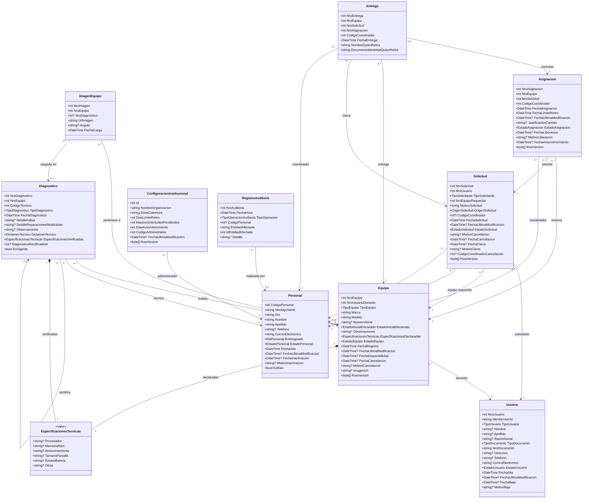

# Modelo UML de clases

## Convenciones

- Cada clase muestra sus propiedades escalares con el tipo del código, incluidas las claves foráneas (`NroEquipo`, `CodigoCoordinador`, etc.). Las propiedades de navegación (`Equipo`, `Coordinador`, etc.) se representan como asociaciones.
- `?` indica que la propiedad admite nulo.
- Las flechas salen de la clase que tiene la propiedad de navegación y apuntan a la clase referenciada. La multiplicidad junto a cada extremo indica cuántas instancias participan.
- `EspecificacionesTecnicas` es un objeto de valor (propiedad compleja de EF): no tiene identidad ni tabla propia y se guarda dentro de `Equipo` y de `Diagnostico`. Se representa con composición.
- `IdentityUserId` (en `Usuario` y `Personal`) referencia a la cuenta de ASP.NET Core Identity, que está fuera de este modelo.
- Las enumeraciones se listan aparte, en la sección de referencia.

## Diagrama

## Reglas del modelo que acotan las multiplicidades

Las multiplicidades del diagrama son las que permite el esquema. Estas restricciones de unicidad (índices únicos de la base) las limitan en la práctica:

- **Asignación vigente:** un equipo tiene como máximo una `Asignacion` con estado `Vigente`, y una solicitud también. Las liberadas y las concretadas se conservan como historial.
- **Entrega:** una asignación se entrega una sola vez (índice único sobre `NroAsignacion`).
- **Solicitud pendiente:** un usuario no puede tener dos solicitudes `Pendiente` para el mismo equipo.
- **Número de serie:** `NumeroSerie` es opcional y único entre los equipos que lo tienen.
- **Configuración institucional:** hay una única fila (`Id = 1`).
- **Borrado:** todas las relaciones restringen el borrado (`Restrict`), de modo que el historial no se pierde.

## Enumeraciones

| Enumeración | Valores |
|---|---|
| `TipoUsuario` | `Persona`, `Institucion` |
| `TipoDocumento` | `Dni`, `Cuit` |
| `EstadoUsuario` | `Activo`, `Inactivo` |
| `RolPersonal` | `Tecnico`, `Coordinador`, `Administrador` |
| `EstadoPersonal` | `Activo`, `Inactivo` |
| `TipoEquipo` | `Notebook`, `PcEscritorio`, `Monitor`, `Celular`, `Periferico` |
| `EstadoInicialDeclarado` | `Funcional`, `ConFallas`, `ParaRepuestos` |
| `EstadoEquipo` | `PendienteRecepcion`, `Disponible`, `EnReparacion`, `Asignado`, `Entregado`, `Baja`, `Cancelado` |
| `TipoDiagnostico` | `Inicial`, `Segundo`, `Rectificacion` |
| `DictamenTecnico` | `Funcional`, `NecesitaReparacion`, `NoRecuperable` |
| `TipoSolicitante` | `Particular`, `Escuela`, `OrganizacionSocial` |
| `OrigenSolicitud` | `Autoservicio`, `Asistida` |
| `EstadoSolicitud` | `Pendiente`, `Asignada`, `Completada`, `Cerrada`, `Cancelada` |
| `EstadoAsignacion` | `Vigente`, `Liberada`, `Concretada` |
| `TipoOperacionAuditoria` | `AltaUsuario`, `BajaUsuario`, `Donacion`, `Diagnostico`, `Solicitud`, `Asignacion`, `Liberacion`, `Entrega`, `AltaPersonal`, `InactivacionPersonal`, `ModificacionParametro`, `InicioSesion`, `CierreSesion`, `IntentoFallidoSesion`, `BloqueoCuenta`, `EdicionPersonal`, `ImagenEquipo`, `ActivacionCuenta`, `ReactivacionPersonal`, `IngresoSinRegistro`, `CorreccionUsuario` |
